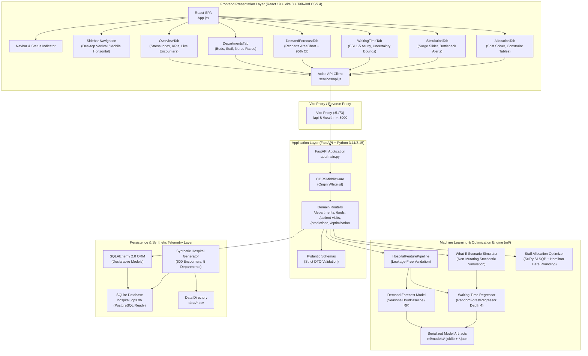

# Architecture Document — Hospital Operations & Workflow Optimization

> B.Tech CSE Major Project Architecture Specification

---

## 1. System Overview

The system is organized as a decoupled, multi-tier architecture consisting of a React 19 single-page application (SPA), an asynchronous FastAPI RESTful backend, a Scikit-Learn / SciPy machine learning and optimization engine, and a declarative SQLAlchemy ORM database layer:



---

## 2. Layer Responsibilities & Component Directory Map

### 2.1 Frontend Client (`frontend/`)
- **Technology:** React 19, Vite 8, Tailwind CSS 4, Recharts 3.x, Axios.
- **Role:** High-performance responsive presentation layer, interactive parametric controls, dynamic visual analytics, and client-side error boundaries.
- **Key Modules:**
  - `src/components/`: Reusable atomic UI elements (`StatCard`, `Navbar`, `Sidebar`, `DisclaimerBanner`, `ErrorAlert`, `LoadingSkeleton`, `Icons`).
  - `src/pages/`: Operational tabs corresponding to the 6 dashboard views (`OverviewTab`, `DepartmentsTab`, `DemandForecastTab`, `WaitingTimeTab`, `SimulationTab`, `AllocationTab`).
  - `src/services/api.js`: Unified HTTP abstraction with automated error message extraction and timeout handling.

### 2.2 Backend Application Service (`backend/app/`)
- **Technology:** FastAPI, Pydantic v2 (`pydantic-settings`), Starlette.
- **Role:** RESTful API orchestration, asynchronous request routing, input validation and sanitization, CORS policy enforcement, database connection management, and service exception handling.
- **Routers:**
  - `routers/departments.py`: Department census, bed occupancy calculations, and nurse ratio auditing.
  - `routers/beds.py`: Physical bed inventories, status toggles, and `/beds/summary` hospital aggregation.
  - `routers/patient_visits.py`: Historical encounter telemetry, recent arrival streams, and triage summary statistics.
  - `routers/predictions.py`: ML model inference endpoints for hourly arrival demand and triage waiting times.
  - `routers/optimization.py`: Hospital-wide operational stress calculation, what-if scenario simulation, and staff allocation optimization.

### 2.3 Machine Learning & Optimization Engine (`ml/`)
- **Technology:** Scikit-Learn, SciPy (`scipy.optimize.minimize`), Pandas, NumPy.
- **Role:**
  - Feature transformation pipelines enforcing strict target leakage elimination via `PROHIBITED_LEAKAGE_COLUMNS`.
  - Serialized model loading (`joblib`) with graceful `503 Service Unavailable` handling on missing artifacts.
  - Hourly arrival time-series prediction with dynamic Poisson 95% confidence intervals.
  - Multi-feature clinical triage waiting-time prediction with non-negativity guarantees.
  - Non-linear constrained staff allocation optimizing queue pressure against staff churn.

### 2.4 Database & Persistence Layer (`backend/app/database.py`, `models/`)
- **Technology:** SQLAlchemy 2.0 ORM, SQLite (local development), PostgreSQL (production target).
- **Entities:**
  - `Department`: Bed capacity, nurse-to-patient target ratios, codes (`ED`, `ICU`, `GEN`, `SURG`, `PED`).
  - `Staff`: Identification, role (`Doctor`, `Triage Nurse`, `Registered Nurse`), assigned department, shift (`Morning`, `Evening`, `Night`), active flag.
  - `Bed`: Bed number, department foreign key, type (`Standard`, `ICU`, `Emergency`, `Pediatric`), occupancy flag.
  - `PatientVisit`: Encounter identifier, arrival/service timestamps, clinical acuity (ESI 1–5), age group, queue length at arrival, derived waiting time, admission flag.

---

## 3. Mathematical Formulations & Optimization Mechanics

### 3.1 Operational Stress Index Formulation
The hospital-wide operational stress index $S \in [0.0, 100.0]$ aggregates physical bed occupancy and active capacity warnings:
$$S = \min\left(100.0, \text{round}\left(0.6 \times \text{BedUtil}_{\text{overall}} + 8.0 \times |\text{ActiveWarnings}|, 1\right)\right)$$
- Normal Operations: $S < 40.0$
- Elevated Pressure: $40.0 \le S < 70.0$
- Critical Stress: $S \ge 70.0$

### 3.2 Staff Allocation Optimization Model
The staff allocation optimizer distributes an integer headcount budget $B$ across the 5 departments to minimize acuity-weighted queue pressure while penalizing drastic staffing churn:

$$\min_{\mathbf{s}} \sum_{i=1}^{5} \left( w_i \cdot \frac{q_i + 1}{\max(1, s_i)} + \lambda \cdot |s_i - s_i^{\text{current}}| \right)$$

**Subject to:**
1. **Total Workforce Budget Conservation:**
   $$\sum_{i=1}^{5} s_i = B$$
2. **Mandatory Patient Safety Minimums:**
   $$s_i \ge s_i^{\min} \quad \forall i \in \{\text{ED}, \text{ICU}, \text{GEN}, \text{SURG}, \text{PED}\}$$
3. **Physical Department Capacity Limits:**
   $$s_i \le s_i^{\max} \quad \forall i \in \{\text{ED}, \text{ICU}, \text{GEN}, \text{SURG}, \text{PED}\}$$
4. **Integer Personnel Constraint:**
   $$s_i \in \mathbb{Z}^+$$
   *Solution Technique:* Solved via SciPy SLSQP followed by Hamilton-Hare largest-remainder quota apportionment, ensuring exact budget conservation with 0 fractional staff.

---

## 4. Security, Privacy & Compliance Architecture

1. **Synthetic Data Isolation:** The platform operates exclusively on mathematically generated synthetic patient and operational data. Zero Protected Health Information (PHI) or real patient records are processed.
2. **CORS Configuration:** Restricted to approved local development and production origin domains.
3. **Environment Security:** Database credentials and deployment keys are loaded via `.env` with `.gitignore` enforcement; no secrets or private keys are committed.
4. **Target Leakage Safeguard:** The feature pipeline verifies that post-arrival features (e.g. `service_start_timestamp`, `length_of_stay_minutes`, `admission_required`) cannot be leaked into inference matrices.

---

## 5. Deployment Architecture & Production Readiness

```
┌────────────────────────────────────────────────────────┐
│                      Client Device                     │
│               (Desktop / Tablet / Mobile)              │
└───────────────────────────┬────────────────────────────┘
                            │ HTTPS (Port 443)
                            ▼
┌────────────────────────────────────────────────────────┐
│                  Nginx Reverse Proxy                   │
│        (SSL Termination, Gzip, Static File Cache)      │
├───────────────────────────┬────────────────────────────┤
│ Location /                │ Location /api, /health     │
│ Serves Vite dist/ bundle  │ Proxies to Uvicorn Cluster │
└─────────────┬─────────────┴─────────────┬──────────────┘
              │                           │
              ▼                           ▼
┌───────────────────────────┐ ┌──────────────────────────┐
│   Static Client Bundle    │ │ Uvicorn ASGI Cluster     │
│   (HTML, CSS, JS, Assets) │ │ (4 Workers on Port 8000) │
└───────────────────────────┘ └───────────┬──────────────┘
                                          │
                                          ▼
                              ┌──────────────────────────┐
                              │ PostgreSQL 16 Database   │
                              │ (Production RDBMS)       │
                              └──────────────────────────┘
```

- **Containerization Readiness:** Standardized Dockerfile and docker-compose configurations allow unified deployment across Linux/cloud environments.
- **RDBMS Portability:** Switching from development SQLite to production PostgreSQL requires only updating `DATABASE_URL` in `.env`.
