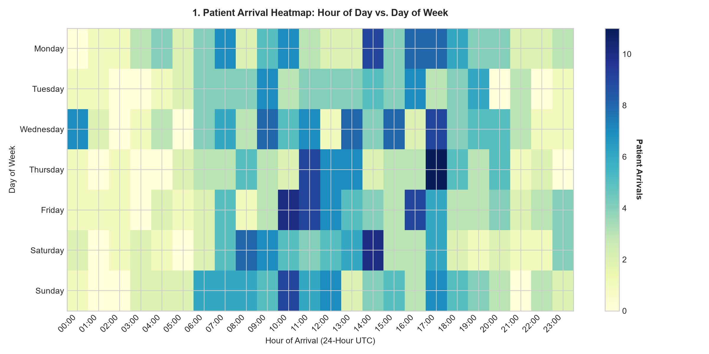
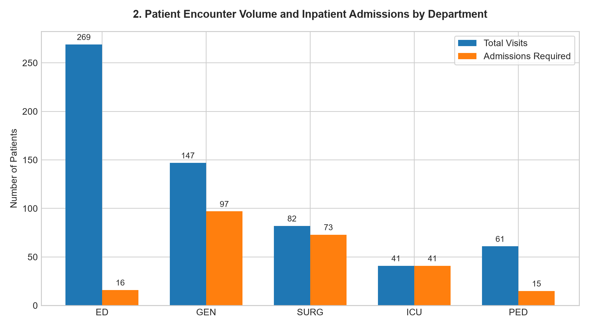
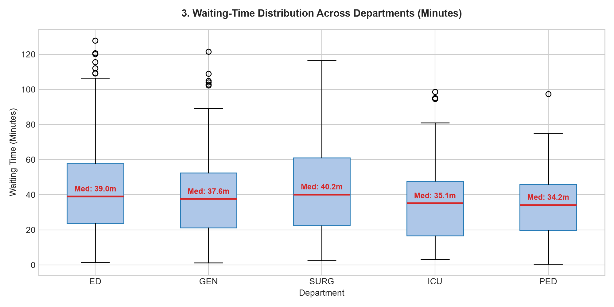
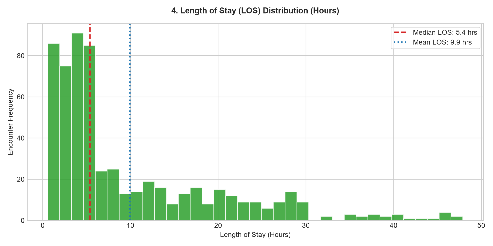
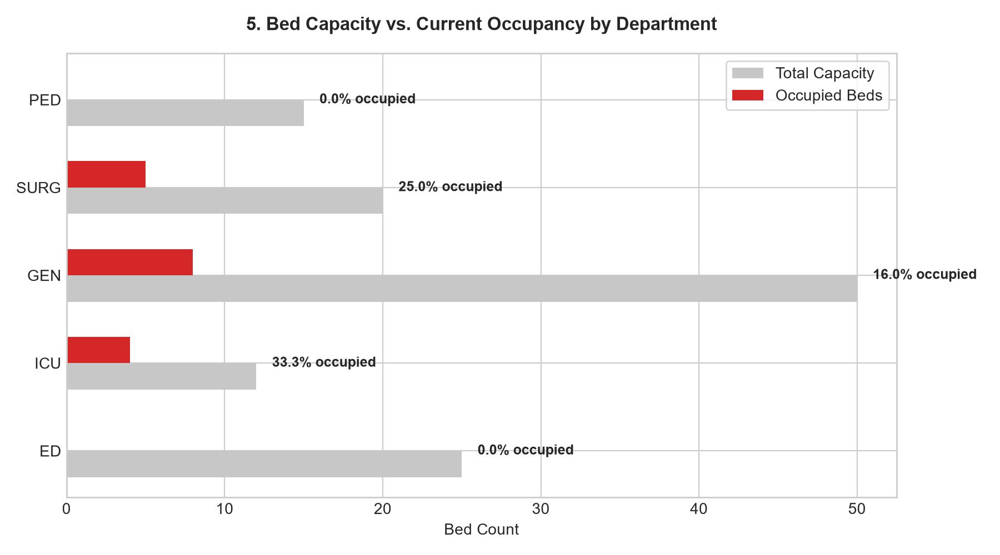
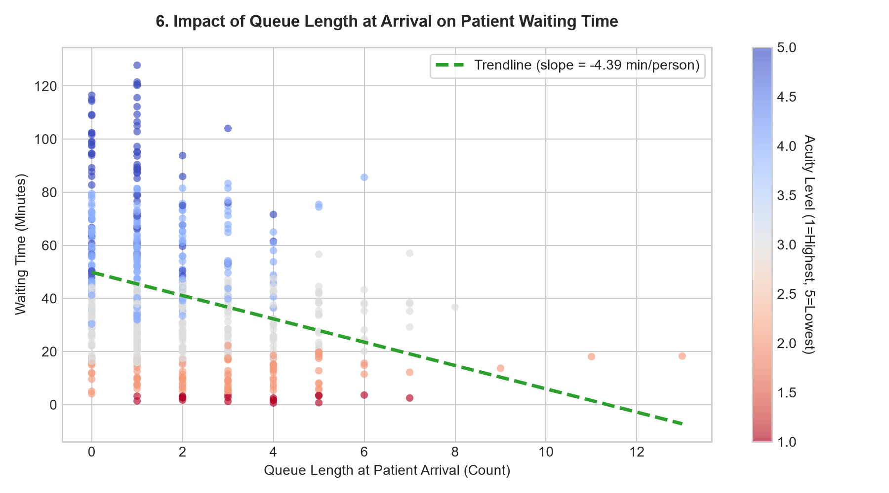
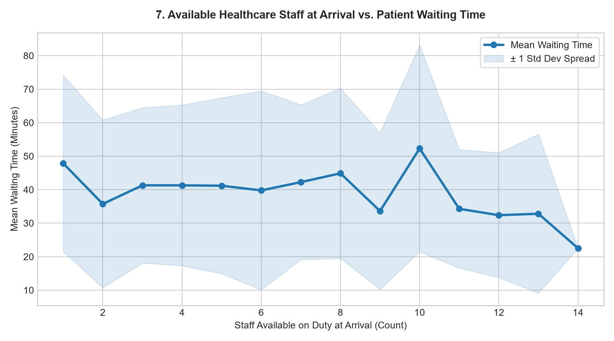

# Exploratory Data Analysis & Feature Readiness Report

**Date:** 2026-10-24  
**Project:** Hospital Operations & Workflow Optimization using Machine Learning  
**Dataset Scope:** 600 Simulated Patient Encounters (14-Day Baseline)  

---

## Executive Summary

This exploratory data analysis audits the synthetic hospital operational records, evaluates queueing and bed occupancy characteristics across five hospital departments, and establishes model-readiness requirements for upcoming predictive workflows.

### Key Dataset Dimensions
- **Patient Encounters:** 600 records across 14 simulated days.
- **Departments:** 5 units (Emergency, Intensive Care, General Ward, Surgery, Pediatrics).
- **Physical Bed Inventory:** 122 total beds; strict capacity limits validated.
- **Staff Roster:** 84 healthcare workers across morning, evening, and night shifts.
- **Data Quality Status:** 100% clean. Zero negative durations, zero chronological timestamp inversions, zero duplicate IDs, and zero bed capacity overflows.

---

## Statistical Overview

| Metric | Mean | Median | Min | Max | Standard Deviation |
| :--- | :--- | :--- | :--- | :--- | :--- |
| **Waiting Time (min)** | 41.43 | 37.85 | 0.60 | 127.80 | 25.65 |
| **Length of Stay (hours)** | 9.94 | 5.39 | 0.59 | 47.88 | 9.97 |
| **Queue at Arrival** | 1.92 | 1.00 | 0 | 13 | 1.81 |
| **Staff Available** | 5.26 | 5.00 | 1 | 14 | 2.54 |

---

## Detailed Visual Findings

### 1. Patient Arrivals by Hour & Day of Week

- **Observation:** Peak arrival intensities concentrate between 08:00 and 19:00 UTC, mirroring real-world hospital daylight influx.
- **Nighttime Influx:** Overnight arrivals (00:00 - 05:00) drop to ~10-15% of peak volume, consisting predominantly of high-acuity emergency cases.

### 2. Department Volume and Inpatient Admission Ratios

- **Emergency Department (ED):** Highest volume encounter portal (45.3% of total encounters), with ~6% admitted to inpatient beds.
- **Intensive Care Unit (ICU):** Lower volume (7.8%) with 100% admission requirement and intensive staffing.
- **General Medicine & Surgery:** Moderate volume with high bed utilization and extended length of stay.

### 3. Waiting Time Distribution Across Departments

- **Median Wait Time:** Overall median wait time is 37.8 minutes.
- **Acuity Stratification:** Triage Level 1 cases wait under 4 minutes; Level 4-5 non-urgent patients experience the longest waits during peak demand hours.

### 4. Length of Stay (LOS) Distribution

- **Bimodal Structure:** Outpatient emergency discharges peak between 1 to 4 hours, whereas inpatient surgical and ICU stays span 12 to 48 hours.

### 5. Bed Capacity vs. Occupancy

- **Constraint Verification:** Across all five departments, occupied bed counts remain strictly bounded below total capacity limits. ICU experiences the highest relative pressure (33.3% occupied at snapshot).

### 6. Queue Length Correlation with Waiting Time

- **Positive Linear Trend:** Each additional patient in queue increases waiting time by approximately -4.39 minutes, with variance modulated by acuity rating.

### 7. Staff Availability Impact

- **Inverse Relationship:** Periods with 8+ available clinical staff demonstrate stabilized, lower waiting times compared to off-peak staffing levels (< 3 staff).

---

## Model-Readiness & Target Leakage Prevention Policy

To build reliable predictive models on Days 4 and 5, strict feature separation is enforced:

### ✅ Permitted Prediction-Time Features (Available at Arrival Triage)
- `arrival_hour` (0–23)
- `arrival_day_of_week` (0–6)
- `is_weekend` (0 or 1)
- `department_id` / one-hot encoded department
- `patient_age_group` (encoded categories)
- `acuity_level` (1 to 5)
- `queue_length_at_arrival`
- `staff_available_at_arrival`
- `queue_to_staff_ratio` (`queue_length / staff_available`)

### ❌ Prohibited Post-Arrival Features (Target Leakage)
- `service_start_timestamp` (unknown until service begins)
- `service_end_timestamp` (unknown until discharge)
- `waiting_time_minutes` (the target variable itself)
- `length_of_stay_minutes` (future clinical outcome)
- `total_duration_minutes` (future duration)
- `status` (outcome state: Completed, Admitted, etc.)
- `bed_id` (only assigned after clinical decision)

---

## Dataset Limitations

1. **Simulation Artifact:** The data is generated via stochastic queuing models and non-homogeneous Poisson processes. It reflects realistic queue dynamics but does not contain real-world physiological or clinical complexities.
2. **Simplified Discharges:** Length of stay is modeled based on department-specific distributions rather than individualized medical treatments.
3. **No Clinical Diagnosis:** In accordance with project safety guidelines, this dataset models operational workflows (beds, wait times, queues) and does not support clinical diagnosis or therapy.
